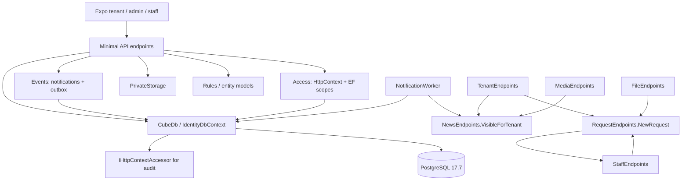

# Архитектурный аудит и план рефакторинга Cube

Дата: 2026-11-11. Репозиторий: https://github.com/Darqn/Cube-hackathon-web-app.
Проверенный commit: `fb35da0d6b87078c3b3587742d51dc0d23f19ee6`.
Статус: аудит и проектирование завершены; изменения приложения ожидают согласования плана по требованию заказчика.

## 1. Вывод

Приложению нужен постепенный рефакторинг внутри существующего монолита. Отдельные сервисы, новые production-проекты, MediatR и Generic Repository сейчас не обоснованы. Хорошие механизмы безопасности и PostgreSQL-транзакций уже реализованы; основной недостаток — смешение HTTP, сценариев, правил доступа и persistence в одних классах.

Цель: функциональные модули в одном `Cube.Api`, самостоятельные сценарии для сложных операций, чистые доменные правила, явные обращения между модулями. Общие `CubeDb`, схема БД и миграции сохраняются. Это применение принципов Modular Monolith / Vertical Slice / Clean Architecture с учётом размера проекта, без заявления о строгой изоляции сборками.

## 2. Область анализа и текущая структура

Изучены все 18 рукописных backend-файлов C#, четыре файла тестов, четыре миграции с designer/snapshot, проекты, точка входа, настройки, CI, скрипты запуска, документация и исходное ТЗ из DOCX. Frontend рассмотрен как потребитель API: HTTP-обёртка, tenant/admin/staff adapters, контракты, структура тестов и конфигурация запуска. Подробный аудит UI и физических мобильных устройств в эту работу не входит.

В `Cube.sln` два проекта; зависимость между проектами односторонняя: `Cube.Tests → Cube.Api`. Циклов между проектами нет. `AGENTS.md` в клонированном репозитории не найден.

| Компонент | Назначение и наблюдение |
| --- | --- |
| `global.json` | SDK 10.0.403, `rollForward=latestPatch`; версия сохранена |
| `src/Cube.Api/Cube.Api.csproj` | ASP.NET Core `net10.0`, nullable включён, warnings as errors; Identity EF / EF Design / OpenAPI 10.0.14, Npgsql EF 10.0.3; lockfile |
| `Program.cs` | DI, Identity, sessions, authorization, rate limiting, CORS, ошибки, заголовки, health, маршруты и три CLI-команды |
| `Security.cs` | В одном файле `ApiError`, `Guard`, токены, authentication handler, `Access`, auth endpoints и request DTO |
| `Domain.cs` | 22 конкретные сущности, базовые `Entity` / `Owned`, общий `Rules`; `User` наследует IdentityUser, остальные модели преимущественно POCO |
| `Data.cs` | Общий IdentityDbContext, все mapping/индексы/constraints, автоматический audit через HttpContext |
| `Administration.cs` | Регистрации, users/staff, tenants, premises/leases, meters, routing, audit, integrations — 23 HTTP-операции |
| `Requests.cs` | Заявки, сообщения, статусы и назначения вместе с tenant/staff/admin показаниями — 14 операций |
| `Staff.cs` | Рабочий кабинет, правила видимости meters/readings/notifications, multipart-ответы и review — 7 операций |
| `TenantFeatures.cs` | Аренда, счета/оплата, notifications, dashboard, listings/inquiries — 19 операций |
| `Files.cs` | PrivateStorage, проверка файлов, upload/download, документы, заявления и request attachments — 12 операций |
| `Media.cs` | PublishedAsset и защищённые вложения новостей / фотографии listings — 6 операций |
| `News.cs` | Публикации, live audience query, receipts, административные операции — 9 операций |
| `Details.cs` | Детальные GET разных областей, отделённые от соответствующих features — 8 операций |
| `Payments.cs` | PaymentRecord и транзакционный PaymentLedger для будущего проверенного callback; публичного settlement endpoint нет |
| `Integrations.cs` | Четыре gateway-контракта, явно выключенные адаптеры и синхронный helper Events для outbox/notifications |
| `NotificationWorker.cs` | Опциональный hosted scheduler локальных in-app уведомлений; внешнюю доставку не выполняет |
| `Validation.cs` | Общий endpoint filter, использующий reflection, nullable metadata и точное совпадение namespace |
| `Seed.cs`, `DemoSeed.cs` | Шесть категорий и отдельная Development-only атомарная demo-команда |
| `Migrations/` | InitialSchema, PublishedMedia, NotificationPreferences, NotificationEventIdentity; PostgreSQL-specific constraints, xmin, upsert |
| `tests/Cube.Tests` | xUnit, WebApplicationFactory, реальный Npgsql/PostgreSQL, временные уникальные БД; architecture tests отсутствуют |
| `tenant-app-frontend/` | Expo 51 / React Native / TypeScript, tenant/admin/staff интерфейсы; unit и Playwright browser tests |
| `scripts/`, `start-cube.bat` | Development setup, миграции, bootstrap, demo и запуск; отдельная Windows regression-проверка |
| `compose.yaml`, `.github/workflows/backend.yml` | PostgreSQL 17.7; CI делает locked restore, Release build, PostgreSQL-backed tests и сохраняет TRX |
| `docs/`, DOCX, JPG/PNG | Требования, предыдущие решения, инструкции и макеты; прежние validation records не принимались за результаты текущего запуска |

Всего в фактическом OpenAPI: **94 пути, 110 HTTP-операций, 53 схемы**. Регистрация OpenAPI выполняется отдельно; операции включают два health endpoint. Контроллеров MVC нет, API целиком Minimal API.

## 3. Карта текущих зависимостей



Цикл `RequestEndpoints ↔ StaffEndpoints` — связь типов/реализаций внутри сборки, а не цикл DI: Requests использует staff query/review, Staff использует `RequestEndpoints.ReviewInput`. Worker и другие features получают бизнес-запросы из HTTP-классов. Эту связанность нужно устранять до изоляции модулей.

## 4. Проблемы и приоритеты

P1 — высокий приоритет для безопасного рефакторинга; P2 — средний; P3 — низкий. Подтверждённого критического нарушения доступа по результатам этого аудита нет; это не заменяет отдельный security assessment.

| ID | Приоритет | Файл / компонент | Проблема, последствие и безопасное решение |
| --- | --- | --- | --- |
| A1 | P1 | `Validation.cs:11` | Валидируются только records с namespace, точно равным `Cube.Api`, через generated `<Clone>$`. Перенос DTO в namespace модулей отключит текущую проверку null/length/array. До переноса зафиксировать поведение и привязать обработку к входному контракту endpoint, сохранив коды/порядок ошибок. Не переходить автоматически на другой формат validation errors. |
| A2 | P1 | `Requests.cs:78`, `Requests.cs:86`, `Staff.cs:87`, `TenantFeatures.cs:52`, `NotificationWorker.cs:23`, `Media.cs:23`, `Files.cs:89` | HTTP-классы используются как application/query API, включая взаимные ссылки. Вынести request creation, visibility и reading review в соответствующие функциональные сценарии; HTTP-классы станут адаптерами. |
| A3 | P1 | `Security.cs:44`, `Data.cs:84` | Access совмещает claims, resource authorization, EF queries и lease rule. CubeDb зависит от HttpContext для audit. Нужна узкая абстракция текущего пользователя для HTTP/background/tests и отдельные policies/query scopes по функциям. Сохранить отсутствие actor audit без пользователя и особые audit для bulk SQL. |
| A4 | P1 | `Requests.cs:23`, `Staff.cs:57`, `Administration.cs:21`, `TenantFeatures.cs:47` | Транзакции, бизнес-проверки, изменения, notifications и HTTP-ответы смешаны. Тестировать сценарии можно в основном через host+DB. Извлекать сложные операции по одной, оставляя один владеющий транзакцией сценарий и прежние атомарные outbox/audit side effects. |
| A5 | P1 | `Files.cs:48`, `Media.cs:27`, `Staff.cs:57` | Три реализации upload повторяют имя/размер/signature/quarantine/write/cleanup; HTTP policies различаются и должны сохраниться. Запись в Files/Media начинается до try, cleanup может скрыть исходную ошибку. Выделить общий storage-механизм, оставив авторизацию и количество/тип файлов у feature. Проверить ошибки записи/БД и partial cleanup до изменения этой части. |
| A6 | P2 | `Administration.cs`, `Requests.cs`, `TenantFeatures.cs`, `Details.cs` | Организация одновременно по роли и техническому действию распределяет одну область между несколькими файлами. Внести admin/staff/tenant endpoints в модули предметной области; агрегирующие dashboards оставить в композиции API. Увеличить читаемость многооператорных строк в затронутом коде. |
| A7 | P2 | `Domain.cs:1`, `Domain.cs:86`, `Data.cs:19` | Все модели и разнородные Rules в общем файле, Identity смешан с доменными POCO, mapping централизован. Разнести правила/модели по владельцам, User оставить Identity infrastructure, mapping — через IEntityTypeConfiguration. Сохранить CLR identity EF-моделей, таблицы, ограничения и порядок общих convention; миграция от рефакторинга не должна требоваться. |
| A8 | P2 | `Integrations.cs:18` | `ToList`, `Any`, `FirstOrDefault` выполняют синхронный DB I/O в async HTTP-сценариях и не принимают CancellationToken. Перевести существующие выборки на async с теми же predicates; создание notifications/outbox остаётся частью текущего SaveChanges/транзакции. |
| A9 | P2 | `NotificationWorker.cs:17` | Загружаются все eligible users; затем queries повторяются на каждого пользователя, каждый reminder — отдельный SQL INSERT. Есть рост числа обращений с числом пользователей/событий. Сначала отделить scheduler от HTTP и покрыть preferences/deduplication/audience, затем измерить SQL и при необходимости оптимизировать. |
| A10 | P2 | `Security.cs:55`, `TenantFeatures.cs:13`, `Details.cs:10`, `Files.cs:69`, `Domain.cs:17` | TimeProvider используется непоследовательно, есть прямое UTC Now. Вынести используемые правила времени, сохранив UTC, включительные даты lease и границы публикации. Не заменять массово timestamps сущностей без characterization tests. |
| A11 | P2 | `Program.cs:35` | Custom mapping ошибок встроен в host, ожидаемые business failures представлены исключениями с HTTP status. Все DbUpdateException становятся 409; при начатом ответе пойманное исключение не пробрасывается. Выделить обработку без изменения текущего wire-контракта; исправление классификации/поведения ошибок рассматривать отдельно как изменение поведения. Добавить структурированный технический контекст без SQL parameters/PII/secrets. |
| A12 | P2 | `News.cs`, `TenantFeatures.cs`, `Files.cs`, `Details.cs` | Часто сериализуются EF entities и anonymous/object/IResult responses. Wire-контракт связан с моделями, OpenAPI неполон: например, GET requests/invoices и POST login описывают 200 без body schema; bearer security scheme отсутствует. Сначала сохранить реальные JSON shapes/status/header/error contracts; DTO вводить с проверкой полного набора полей. Улучшение самого OpenAPI — отдельный согласованный diff публичной спецификации. |
| A13 | P2 | `tests/Cube.Tests` | Хорошее поведенческое integration coverage, но нет автоматических границ модулей и полного API compatibility baseline; ограничены failure-path/временные cases. Расширить существующий xUnit без новых зависимостей: контракты, входные ошибки, boundaries, storage rollback, architecture и DI validation. Тесты должны проверять результаты, а не только вызовы mocks. |
| A14 | P3 | `Program.cs:9`, `Security.cs:12` | DI/host policies и различные validation helpers плохо локализованы по ответственности. Выделить методы регистрации по реальным модулям и host middleware. Не создавать интерфейс каждому классу и не вводить общий BaseService/Repository. |

### Что уже сделано хорошо

- DbContext и Access scoped; PaymentLedger scoped; TimeProvider, storage и stateless disabled gateways singleton. Worker создаёт scope на tick; захвата scoped DbContext singleton-сервисом не обнаружено. ServiceProvider в DI factory и worker/CLI composition сам по себе не является произвольным Service Locator внутри бизнес-операции.
- Оpaque tokens хешируются, сверяются с текущим пользователем, stamp и блокировкой tenant. Login lockout, logout, password operations, Admin policy и resource scopes уже есть. Нельзя заменять эти решения ради JWT/кеша с ослаблением немедленного отзыва доступа.
- В БД есть tenant-consistent составные foreign keys, уникальные ограничения, precision/check constraints, xmin concurrency для requests/meters. Reading review использует compare-and-set, ledger — transaction и `FOR UPDATE`, receipts/notifications — параметризованные atomic upserts.
- Большинство I/O уже async с CancellationToken; `async void`, `.Result` и `.Wait()` в backend не найдены. UserManager не предоставляет CancellationToken во многих используемых методах; это не повод создавать фиктивный проброс.
- Есть AsNoTracking, pagination, Select, joins и явные ограничения доступа. Вложенные Select в EF-проекциях requests — серверные подзапросы, их нельзя автоматически объявлять N+1. Подтверждённая повторяемость запросов находится в worker/Events.
- Секреты не требуются в committed appsettings; CORS использует явный allowlist; файлы приватны и quarantined вне явного Development opt-in. Production upload scanning отсутствует по документированному решению, а не должен имитироваться новым рефакторингом.
- Live 1C/Bitrix/payments/email выключены по существующему решению компании. `UnconfiguredIntegrations` — намеренный контракт состояния; его нельзя удалять или заменять фиктивной успешной реализацией.

## 5. Предлагаемые границы и структура

```text
src/Cube.Api/
  Program.cs
  Api/                  # host configuration, middleware, dashboards composition
  Modules/
    Identity/           # login, registration/approval, profile, users/staff, sessions
    Property/           # tenants, premises, leases, listings
    Requests/           # categories/routing, create, conversation, assignment, status
    Metering/           # meters, readings, baseline corrections, staff/admin review
    Billing/            # invoices, payment history/attempts, verified ledger
    Documents/          # documents, statements; file access policies у потребителей
    News/               # publication/audience, receipt/ack, attachments policies
    Notifications/      # inboxes, notification creation, scheduler
  Workflows/            # application-композиция, например RentalInquiry
  Infrastructure/
    Persistence/        # общий CubeDb, configuration, audit
    Storage/            # общий приватный storage-механизм
    Integrations/       # существующие disabled adapters и outbox persistence
  Common/               # только реально общие actor/error/identity primitives
  Migrations/           # существующие файлы без правок
tests/Cube.Tests/
  Unit/                 # pure rules и независимые сценарии
  Integration/          # HTTP/PostgreSQL/файлы, существующие тесты сохранены
  Architecture/         # проверяемые границы и composition/DI
```

Дерево — карта ответственности, не обязательство создать каждый каталог. `Features/ChangeStatus` и отдельный handler нужны сложному сценарию; простая read-only операция может оставаться одним feature-файлом. Не создавать отдельный module Staff/Admin: это роли и API-представления тех же business capabilities. Infrastructure interfaces добавляются только на реальных границах, например current actor и файловое I/O для проверки сбоев.

Правила зависимостей:

1. Domain rules не используют HTTP, EF, storage и endpoint types. Identity User не выдаётся за чистую доменную сущность.
2. HTTP получает вход, применяет authorization, вызывает сценарий и отображает исход в прежний HTTP-контракт. Application-сценарий не принимает HttpContext/HttpRequest и не возвращает IResult.
3. Межмодульное обращение идёт через конкретную операцию/контракт владельца, а не его endpoint helper. Requests/Metering используют Property lease contract; составной RentalInquiry workflow координирует Property и Requests, не создавая обратную зависимость Property → Requests. Scheduler использует news audience contract; inbox queries используют resource visibility contracts. Создание notifications/outbox идёт через небольшой общий контракт записи, без обратной зависимости Requests → Notifications inbox. Отдельная шина событий для этого не нужна. Общие операции БД остаются в одной транзакции там, где это делается сейчас.
4. EF остаётся механизмом persistence. В простых feature queries допустим прямой EF; это осознанное ограничение строгости Clean Architecture. Для сложных независимо тестируемых сценариев используются только необходимые узкие порты. Generic Repository не нужен.
5. Одна сборка и один DbContext дают логические, а не compile-time границы модулей. Их проверяют architecture tests; разбиение на проекты возможно позже при доказанной необходимости. Не объявлять весь монолит строго изолированным после одного переноса файлов.
6. DI — constructor injection для сценариев; регистрации `AddIdentityModule`, `AddRequestsModule`, `AddMeteringModule`, общий persistence/storage и HTTP-host configuration. Existing CLI flags и worker enablement сохраняются.

На первых шагах перемещение файлов не требует изменения namespace EF entities или имён HTTP record schemas. API records сохраняют существующие имена и JSON-поля; при необходимости временно остаются входными адаптерами в прежнем namespace. Для application/domain вводятся только действительно нужные параметры/модели. Это позволяет избежать неявных изменений EF metadata, OpenAPI и null validation.

## 6. Последовательный план после согласования

| Шаг | Реальное изменение | Почему | Проверка и условие завершения |
| --- | --- | --- | --- |
| 0 — выполнен | Read-only audit, locked restore, исходная Release build, все существующие tests, runtime OpenAPI baseline | Есть воспроизводимая отправная точка | 49/49, без warnings/errors; исходники/lockfiles/миграции не менялись |
| 1 — P1, characterization | Сохранить проверяемый API baseline; добавить случаи обязательных/null/oversized полей, коды ProblemDetails, JSON/status/Location/header contracts; DI ValidateScopes/ValidateOnBuild | Перемещения особенно опасны из-за Validation namespace и неполной OpenAPI metadata | Тесты проходят на исходной реализации до production-изменений; timestamp/trace/GUID сравниваются по семантике, а не случайным значениям |
| 2 — P1, подготовка границ | Убрать привязку validation к точному namespace, извлечь actor adapter, сгруппировать DI и middleware; сохранить текущую классификацию ошибок и порядок pipeline | Разблокирует безопасное выделение features | Полный suite + validation/auth/error/DI cases; model и runtime contracts без семантических изменений |
| 3 — P1, первая функциональная итерация | Requests: create/factory, status/history, assignment, conversation и attachments policies; Metering: visibility, submission, review; workspace endpoints делегируют этим сценариям | Устраняет цикл RequestEndpoints/StaffEndpoints; дублирование и сложные сценарии становятся локальными | Existing assigned-resource, private comments/files, revocation, xmin, compare-and-set tests + новые pure rule/failure tests; outbox/notifications/audit атомарны; нет ссылок application → endpoints |
| 4 — P1/P2, последовательные модули | По одному: Property → Billing → Documents/storage → News/Notifications → Identity. Детальные и administrative routes переезжают к владельцам. Общий upload и async notifications извлекаются только при переходе соответствующего модуля | Не смешивает весь монолит в один большой diff; сохраняет понятные контрольные точки | После каждого модуля build/full tests/contracts; ledger, receipt upsert, targeting и file visibility сохраняют поведение. Каждая итерация имеет собственный отчёт |
| 5 — P2, persistence и закрепление | Разделить конфигурации IEntityTypeConfiguration без правок схемы; убрать остаточные зависимости endpoint-to-endpoint, обновить архитектурные проверки и документацию | Поддерживаемые зависимости и защита от возврата связанности | Равенство relational model до/после, отсутствие pending model changes, migrations/lockfiles без diff; build/full tests/contracts; frontend проверки для затронутых wire-сценариев |

Первый согласуемый объём реализации — шаги 1–3. Шаги 4–5 задают продолжение по модулям, а не массовое перемещение всех файлов. Отдельный проект ArchitectureTests не требуется: начать в текущем test project. Новые NuGet/npm зависимости, изменение .NET, БД и production-настроек в план не включены.

## 7. Проверка корректности и риски

| Риск | Как контролировать |
| --- | --- |
| DTO relocation отключит validation или поменяет schema names | Сначала characterization, затем filter; сохранять имена HTTP contracts; проверять required/null/length/array |
| Изменится tenant/staff visibility | Матрица guest/Tenant A/Tenant B/Staff/Admin на чтение, изменение и скачивание; повторная проверка после reassignment/route change/block |
| Извлечение handlers разорвёт transaction/outbox/audit | Один сценарий владеет единицей работы; тестировать отказ до commit, конкурентные операции, сохранённые строки и уведомления |
| EF mapping/convention relocation изменит схему | Зафиксированные миграции и source hashes, сравнение relational model, pending model check; не генерировать/применять новую migration ради перемещения |
| DTO перестанет включать «лишние» поля исходной entity | Сравнивать реальные JSON body: casing, поля/null, decimals/dates/version, array/envelope, статусы, headers и Location. Не удалять публичные поля без решения заказчика |
| OpenAPI даст ложную уверенность | У него сейчас неполные body/auth/error metadata. Использовать вместе с HTTP characterization; улучшения OpenAPI выделять отдельно |
| Изменятся UTC и дата lease/news | Fixed TimeProvider, проверки inclusive lease days и PublishAt/ExpiresAt; никаких business timezone изменений |
| Upload cleanup/async cancellation изменят side effects | Проверять invalid file, quarantine, disk/DB failures, cancellation, отсутствие частичных messages/attachments; не расширять доступ ради общей реализации |
| Architecture tests проверят только директории | Проверять также реальные типовые зависимости и использование HTTP в сценариях; явно учитывать, что одна сборка не даёт compile-time изоляции |
| Начнётся преждевременная оптимизация | Сначала сохранить поведение, отдельно измерять SQL/allocations. Не распараллеливать операции одного DbContext, не кешировать authorization без решения об отзыве доступа |

### Что требует отдельного согласования и не выполняется автоматически

- Исправление классификации DbUpdateException, изменение поведения после Response.HasStarted, новый формат/коды ошибок или новые правила валидации.
- Новые бизнес-правила: повторный review заявления, другое поведение concurrent listing inquiry, новые статусы, категория поддержки, роли, timezone, доставка уведомлений.
- Изменение JSON/OpenAPI публичной спецификации, схемы/индексов/миграций БД, .NET/ключевых библиотек и production configuration.
- Включение реальных integrations, email recovery delivery, scanner workflow или автоматического outbox replay.

## 8. Выполненные проверки

Команды запускались в корне клонированного репозитория. SDK установлен только в `/workspace/.cube-tools/dotnet`; `DOTNET_CLI_HOME` и `NUGET_PACKAGES` направлены в локальные каталоги окружения. Ограничения песочницы на IPC NuGet / сетевой proxy / Docker socket потребовали запуска команд через разрешённый execution tool за пределами песочницы. Версии проекта и конфигурация production не изменялись.

```bash
dotnet restore Cube.sln --locked-mode
dotnet build Cube.sln --configuration Release --no-restore
dotnet test Cube.sln --configuration Release --no-build --no-restore \
  --results-directory /workspace/.cube-tools/audit-baseline \
  --logger 'trx;LogFileName=backend.trx'
```

- Locked restore: успешно для обоих проектов.
- Release build: успешно, **0 warnings, 0 errors**.
- Tests: **49 passed, 0 failed, 0 skipped**; 14 unit test cases и 35 integration tests. Использован реальный PostgreSQL 17.7 с digest из `compose.yaml`, отдельный временный контейнер без named volumes проекта и loopback-порт 55432. Fixtures создавали собственные уникальные базы и применяли реальные миграции. Проверки включают tenant/staff boundaries, internal files/messages, session/block/logout, registration approval, xmin/compare-and-set concurrency, payment replay/overpayment, news timing/receipt/deduplication и demo atomicity.
- OpenAPI: фактический Kestrel в Testing на loopback:55080, worker выключен; GET `/openapi/v1.json` успешно сохранён. Временный процесс остановлен. Это не проверка production-развёртывания.
- После тестов запрос к `pg_database` подтвердил отсутствие оставшихся `cube_tests_%` баз (0). Временный контейнер PostgreSQL остановлен и автоматически удалён; файлы данных проекта не использовались.
- Артефакты окружения: `/workspace/.cube-tools/audit-baseline/backend.trx`, `openapi.json`, `routes.txt`, `source-hashes.json`; последний содержит SHA-256 миграций, global.json и NuGet lockfiles.
- Не запускались в этом аудите: frontend npm/typecheck/Playwright, Windows launcher, production load/restore/security assessment и реальные внешние интеграции. Старые отчёты о них не считаются результатами этой сессии.

## 9. Изменения и критерии текущего этапа

Изменение в репозитории — только этот отчёт. C#, csproj, frontend, конфигурация, зависимости и миграции не редактировались. SDK, временная БД и результаты проверок находятся вне tracked исходников; production-данные не использовались.

Аудит дал конкретные владельцы ответственности, карту зависимостей, выявленный риск validation при переносе namespace и проверенную зелёную исходную базу. Архитектурные недостатки из раздела 4 пока остаются. Критерии завершения всего рефакторинга — feature organization, независимость бизнес-сценариев, новые архитектурные ограничения и расширенное characterization coverage — ещё не выполнены, поскольку реализация должна начаться после согласования этого плана.
