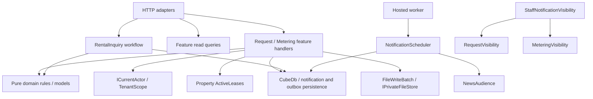

# Архитектура Cube после рефакторинга

Cube остаётся одним ASP.NET Core приложением и одной PostgreSQL базой. Функциональные модули расположены в одном проекте; отдельные deployment units, MediatR и repository поверх каждого DbSet не вводились. [Аудит](architecture-audit.md) описывает исходную точку, [отчёт по этапам](refactoring-progress.md) — изменения, проверки и ограничения.

## Владельцы кода

| Каталог | Ответственность |
| --- | --- |
| `Api/` | Host configuration, middleware, validation, совместимые HTTP contracts, агрегирующие dashboards и общая HTTP-работа с media |
| `Modules/Identity` | Authentication, регистрация/approval, профиль, users/staff; Identity framework types остаются в infrastructure |
| `Modules/Property` | Tenant organizations, premises, leases, listings; active lease query |
| `Modules/Requests` | Categories/routing, заявки, conversation, assignment/status/history, attachments и staff replies |
| `Modules/Metering` | Meters/readings, corrections, visibility по ответственности, submission/review |
| `Modules/Billing` | Invoice API/rules и существующий verified settlement ledger |
| `Modules/Documents` | Документы, заявления, private file operations и reference validation |
| `Modules/News` | News API, live audience query, receipts/ack и domain models |
| `Modules/Notifications` | Tenant/staff inbox, resource visibility, scoped scheduler и hosted lifecycle adapter |
| `Workflows/` | Application-композиция нескольких областей: RentalInquiry создаёт связанную заявку и inquiry в одной единице сохранения |
| `Common/` | Базовые сущности, actor/storage ports, business outcomes; legacy Guard не используется в новых feature handlers |
| `Infrastructure/` | Общий CubeDb/audit, приватное storage, outbox/notification persistence, выключенные integrations, seed/CLI data |
| `Migrations/` | Исходные миграции и snapshot без изменений |

Физическое расположение моделей отражает владельца, но их CLR namespace `Cube.Api` сохранён: изменение имён EF metadata не требуется для улучшения организации. Для новых компонентов используются namespaces модулей. DTO-контейнеры `AdminEndpoints` и `TenantEndpoints` в `Api/Contracts` содержат только прежние входные контракты; business endpoints больше не сгруппированы в этих общих классах.

## Направления зависимостей

Domain rules не используют ASP.NET Core или EF. Новые feature handlers и workflow не принимают HttpContext/HttpRequest, не возвращают IResult и не вызывают endpoint helpers. Ожидаемый отказ представлен `Outcome<T>`/`Failure`; API отображает его в прежний HTTP status и ProblemDetails с `code`/`traceId`. Технические DB exceptions продолжают проходить через middleware с прежней классификацией.

Прямой EF внутри feature queries/handlers — осознанный выбор для данного монолита. Общий DbContext сохраняет cross-feature transaction и tenant-consistent foreign keys. Это не строгая Clean Architecture с compile-time изоляцией persistence. Простые CRUD и часть Identity API сохраняют прямые EF/UserManager вызовы; отдельные обработчики вводились там, где координация, правила и транзакции дают практическую пользу.

## DI и текущий пользователь

Program явно компонует HTTP adapters. Host extension вызывает регистрации Infrastructure, Identity, Requests, Metering и Notifications, а также регистрирует общие application-компоненты. DbContext, actor, scopes и handlers — scoped. Storage — singleton без scoped-зависимостей. NotificationWorker создаёт scope на tick и разрешает scoped scheduler только внутри него.

`HttpCurrentActor` читает актуальный principal при обращении: DbContext может создаваться authentication handler до установки claims. Фиксация пользователя в конструкторе нарушила бы audit. В background scope пользователь отсутствует; audit actor не придумывается. Для сценариев вне HTTP можно предоставить свой `ICurrentActor`.

## Валидация и совместимость

1. Входной HTTP record реализует `IApiRequest`; endpoint/group применяет `InputValidationFilter`. Проверка не зависит от namespace и compiler-generated `<Clone>$`.
2. Filter сохраняет исходные required/null, string и array ограничения и коды ошибок. Он не заменяет правила feature и resource authorization.
3. Сохраняются маршруты, методы, JSON fields/casing, значения статусов, версии, пагинация, Location и security headers. Прежние EF entities/anonymous responses не заменялись автоматически более узкими DTO.
4. OpenAPI baseline проверяет весь документ, кроме deployment-specific `servers`. Нельзя перезаписывать baseline только для успешного теста: изменение публичной спецификации требует отдельного review/согласования.
5. OpenAPI пока неполон для ряда response bodies/auth/error metadata, поэтому дополнительно проверяются реальные JSON и error responses, resource boundaries и browser workflows.

## Persistence и файлы

Общие conventions — tenant FK/index и string/decimal facets — применяются в CubeDb в прежнем порядке. Настройки конкретных сущностей вынесены в `IEntityTypeConfiguration` в соответствующие `Persistence/ModelConfiguration.cs`, а storage/outbox — в Infrastructure. Регистрация конфигураций явная, без assembly scanning. Test `HasPendingModelChanges()` сравнивает модель с неизменённым migration snapshot.

У request/meter остаётся xmin concurrency; review использует compare-and-set; ledger — исходный PostgreSQL transaction/row lock; receipts и scheduled notifications — параметризованные atomic upserts. Notification/outbox rows сохраняются в той же единице работы, что и business changes. Async notification helpers принимают CancellationToken и сохраняют прежние recipient predicates.

`UploadedFileReader` выполняет общую проверку размера/имени/signature. Feature сохраняет собственные требования к количеству, виду и доступу. `FileWriteBatch` записывает файлы и вызывает DB commit; при отказе/отмене удаляет все попытки записи, включая частично записанный файл. Ошибка cleanup логируется без filename/content и не скрывает исходное исключение. Это best-effort compensation, а не распределённая транзакция: аварийное завершение процесса всё ещё может требовать восстановления/сверки storage и БД. Production quarantine и необходимость настоящего scanner workflow сохранены.

## Развитие и проверки

Новую возможность следует добавлять в модуль-владелец. Для сложного сценария достаточно feature-файла с handler и необходимыми параметрами/правилами; отдельные Command/Query/Validator/Repository для каждого простого GET не нужны. Cross-feature workflow координируется отдельно, чтобы избежать обратных зависимостей между областями.

Существующая CI-команда `dotnet test Cube.sln --configuration Release` запускает:

- Pure rule tests, независимые вызовы application handlers и PostgreSQL integration tests.
- API/OpenAPI/ProblemDetails, DI ValidateScopes/ValidateOnBuild и migration snapshot parity.
- Resource authorization, concurrency, rollback, private/quarantined uploads, media targeting и scheduler preferences/deduplication.
- Architecture tests по signatures и IL, включая async state machines: domain без HTTP/EF; handlers/workflows без HTTP, Service Locator и endpoint types; отсутствие циклов между namespaced module components.

Одна сборка и сохранённые namespace EF entities ограничивают полноту автоматического module graph: проверки не доказывают изоляцию всех обращений к чужим DbSet. Для строгих compile-time границ понадобилось бы отдельное обоснованное разделение сборок. Frontend API adapter tests, TypeScript и Playwright остаются дополнительными проверками потребителей API.

Нерешённые вопросы, требующие отдельного решения: прежний 500 для некоторых tenant queries без tenant-контекста; классификация всех DbUpdateException как 409; обработка после Response.HasStarted; изменение бизнес-правил review/inquiry; batching scheduler; production scanner/storage recovery и реальные интеграции. Они не были незаметно изменены под видом архитектурного рефакторинга.
