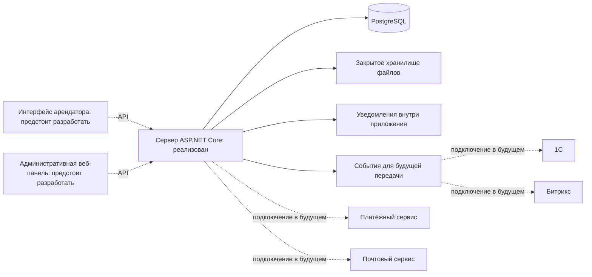

# Cube: обзор проекта и выполненная работа

Материал для подготовки презентации. Здесь описаны назначение приложения, готовая серверная часть и следующие этапы разработки: пользовательские интерфейсы, интеграции и подготовка к запуску.

## 1. Коротко о проекте

**Cube — личный кабинет арендатора коммерческой недвижимости:** офисов, складов и торговых помещений. Приложение должно объединить информацию об аренде, счета, документы, обращения, показания счётчиков и объявления управляющей компании.

В проекте предусмотрены приложение для арендаторов и отдельная административная веб-панель. Сотрудники компании работают с обращениями по своим направлениям.

**На текущем этапе разработана и протестирована серверная часть.** Пользовательские интерфейсы пока представлены макетами. Подключение внешних сервисов оставлено на следующие этапы по согласованию с заказчиком.

Текст для начала презентации:

> Cube объединяет повседневные вопросы арендатора в одном личном кабинете: от просмотра договора и счёта до обращения в техническую службу. Серверная основа уже разработана и проверена. Следующие шаги — создание интерфейсов и подключение внешних систем.

## 2. Какие задачи решает приложение

Проект призван упростить взаимодействие арендаторов с компанией и сделать историю действий доступной в одном месте.

| Задача | Возможности приложения |
| --- | --- |
| Получить сведения об аренде | Список помещений, условия и сроки договоров |
| Разобраться в начислениях | Счета, остаток к оплате и просроченная задолженность |
| Обратиться к нужному сотруднику | Категории обращений, назначение ответственного, переписка и история статусов |
| Передать показания | Показания воды и электричества, фотографии и результаты проверки |
| Найти нужный документ | Договоры, дополнительные соглашения, заявления и другие файлы |
| Подобрать дополнительное помещение | Объявления, фотографии, фильтры и заявки на аренду |
| Узнать о работах или авариях | Адресные новости, срочные объявления и подтверждение ознакомления |

Ожидаемый результат — более удобное обслуживание арендаторов и меньше разрозненных переписок. Фактическое сокращение нагрузки, времени ответа или затрат пока не измерялось.

## 3. Пользователи и их возможности

- **Арендатор** видит сведения своей организации, просматривает счета и документы, создаёт обращения, передаёт показания и читает объявления.
- **Сотрудник компании** работает с назначенными ему обращениями и отвечает арендаторам. Внутренние комментарии сотрудников скрыты от арендаторов.
- **Администратор** подтверждает регистрацию, управляет арендаторами и сотрудниками, помещениями, договорами, документами и публикациями, назначает ответственных и просматривает журнал действий.

У одной организации может быть несколько учётных записей. В текущей модели каждая учётная запись арендатора связана с одной организацией.

## 4. Что было сделано

### Изучены требования и подготовлен план

Перед началом разработки были изучены техническое задание компании и все пять макетов экранов. Затем составлен план: структура серверной части, модель данных, правила доступа, основные сценарии, интеграции и проверки.

В ходе согласования приняты два решения:

1. **Не подключать внешние системы без документации.** Вместо действующих интеграций подготовлены программные интерфейсы и сохранение событий для будущей передачи.
2. **Следовать письменному техническому заданию.** Реализованы шесть категорий обращений. Дополнительная категория про интернет и телефонию, показанная только на макете, отложена.

### Разработаны основные серверные функции

| Раздел | Что реализовано |
| --- | --- |
| Учётные записи | Заявка на регистрацию, подтверждение администратором, вход и выход, смена пароля, профиль, настройки уведомлений и блокировка доступа |
| Арендаторы | Карточки организаций, учётные записи сотрудников и разграничение доступа к данным |
| Помещения и договоры | Сведения о помещениях и договорах, привязка к арендатору и данные для главной страницы |
| Обращения | Шесть категорий, настройка ответственных, переписка, внутренние комментарии, вложения и история статусов |
| Счётчики | Учёт воды и электричества, проверка новых показаний, привязка фотографий, рассмотрение и отдельная процедура исправления исходного значения |
| Счета | Ручное добавление администратором, просмотр счетов и PDF, расчёт остатка и задолженности, история платежей и механизм учёта будущих подтверждённых оплат |
| Документы | Закрытая загрузка и скачивание, заявления арендаторов, шаблоны, категории документов, архивирование и рассмотрение |
| Свободные помещения | Публикация объявлений, фильтры, фотографии и создание обращения по заявке на аренду |
| Новости | Черновики, отложенная публикация, срок действия, архив, важность, выбор аудитории, вложения и подтверждение ознакомления |
| Уведомления | Уведомления внутри приложения и фоновая задача для новостей и напоминаний о счетах и показаниях |
| Среда разработки | Настройка PostgreSQL, обновления структуры базы данных, сценарии установки и запуска, описание API и конфигурация автоматических проверок |

**Онлайн-оплата пока недоступна.** Для восстановления пароля подготовлены серверные методы, но отправка писем ещё не подключена. Эти возможности требуют внешних сервисов.

### Настроена защита данных

Пароли хранятся в виде защищённых хешей. Сеансы доступа имеют срок действия и могут быть отозваны. При выходе, смене пароля или блокировке доступ прекращается.

Сервер проверяет, кому принадлежат запрашиваемые данные. Ограничения базы данных дополнительно защищают связанные записи от ошибочной привязки к чужому арендатору. Для обращений и показаний предусмотрена защита от конфликтующих одновременных изменений.

Механизм учёта подтверждённых платежей использует транзакции и проверку идентификатора операции, чтобы одна оплата не учитывалась повторно.

Файлы хранятся в закрытом каталоге и проверяются по размеру и формату. **В рабочей среде загруженные файлы остаются в карантине до подключения проверки на вредоносное содержимое.** Использование файлов без такой проверки разрешается только отдельной настройкой среды разработки.

## 5. Как устроена система

Серверная часть построена как **модульный монолит**: одно приложение, внутри которого разделены функции учётных записей, аренды, обращений, документов и других разделов. Такой подход упрощает разработку и позволяет выполнять связанные изменения в одной базе данных.

Клиентские приложения будут обращаться к серверу через API — набор методов для получения данных и выполнения действий. Для разработчиков интерфейса подготовлено описание этих методов в формате OpenAPI.

| Технология | Для чего используется |
| --- | --- |
| ASP.NET Core 10 и C# | Серверная логика и API |
| Entity Framework Core 10 | Работа с данными и обновление структуры базы |
| Npgsql | Подключение к PostgreSQL |
| PostgreSQL 17 | Хранение данных и обеспечение их целостности |
| ASP.NET Core Identity | Защита паролей и операции с учётными записями |
| OpenAPI | Описание методов сервера для команды интерфейса |
| Docker Compose | Запуск локальной базы данных |
| xUnit | Автоматические тесты |
| GitHub Actions | Подготовленная конфигурация автоматической сборки и тестирования |

Пунктиром обозначены связи, которые ещё предстоит реализовать. Схема показывает общую архитектуру, а не наличие действующих внешних подключений.

## 6. Пользовательский интерфейс

В репозитории есть пять макетов приложения арендатора:

1. **Главная страница:** арендуемые помещения, счета, важные объявления и быстрые действия.
2. **Обращения:** категории, список заявок, статусы и переход к переписке.
3. **Документы:** договоры, дополнительные соглашения, заявления, акты, счета-фактуры и УПД.
4. **Актуальные помещения:** карточки объектов, фильтры, фотографии и заявки на аренду.
5. **Новости и оповещения:** объявления, срочные события, отметки о прочтении и подтверждение ознакомления.

Макеты выполнены в тёмной цветовой гамме с золотыми акцентами и фирменной символикой. Они задают направление дизайна. **Работающий пользовательский интерфейс в рамках этой разработки не создавался.**

Команда интерфейса может использовать методы `/api/v1` и описание OpenAPI. Конкретная технология интерфейса пока не выбрана. Сервер может обслуживать веб-приложение и мобильные клиенты, но каждый из них необходимо отдельно разработать и проверить.

Для сотрудников и администраторов потребуется отдельная веб-панель. Она должна предоставлять доступ к подтверждению регистрации, арендаторам, помещениям, договорам, документам, счетам, обращениям, показаниям, объявлениям, новостям и журналу действий.

При разработке интерфейса важно предусмотреть понятные сообщения об ошибках, состояния загрузки, проверку форм, завершение сеанса и ход загрузки файлов. Недоступные функции должны быть обозначены явно: до подключения платёжного сервиса кнопка оплаты не должна создавать впечатление, что платёж можно провести. Отметку «Прочитано» и действие «Ознакомлен» также следует показывать отдельно.

## 7. Интеграции: назначение и готовность

| Система | Для чего нужна | Что подготовлено |
| --- | --- | --- |
| **1С** | Получение данных арендаторов и счетов, обмен сведениями о подтверждённых оплатах | Программный интерфейс для исходящей передачи и сохранение событий оплаты. Получение счетов и действующий обмен ещё не реализованы |
| **Битрикс** | Передача обращений и показаний ответственным сотрудникам, обмен сообщениями и статусами | Программный интерфейс и сохранение событий для передачи. Действующего обмена и двусторонней синхронизации пока нет |
| **Платёжный сервис** | Переход к оплате и получение подтверждения платежа | Интерфейс будущего подключения и механизм учёта подтверждённых оплат. При попытке открыть оплату сервер явно сообщает, что сервис не настроен |
| **Электронная почта** | Сообщения об одобрении регистрации и восстановление пароля | Интерфейс подключения и сохранение запросов на отправку. Письма пока не отправляются |
| **Push и SMS** | Дополнительные каналы оповещения | Не реализованы |

События для будущих интеграций сохраняются со статусом `AwaitingConfiguration` — «Ожидает настройки». Это позволяет сохранить информацию о необходимых действиях, не выдавая её за успешную отправку или оплату.

Когда появится документация внешних систем, потребуется реализовать конкретные способы подключения, сопоставление записей, проверку входящих уведомлений, повторные попытки передачи и сверку результатов. После этого необходимо провести проверки в тестовых средах поставщиков.

Подключение внешних систем исключено из текущего объёма работ по согласованию с заказчиком: документация недоступна в связи с корпоративной политикой.

## 8. Как проверялась работа

Зафиксированы следующие результаты:

- **37 автоматических тестов прошли успешно. Ошибок — 0, пропущенных тестов — 0.** Проверки включают отдельные правила и работу API с настоящей PostgreSQL.
- Сборка Release завершилась **без ошибок и предупреждений компилятора**.
- Проверены разграничение доступа, назначение сотрудников, скрытие внутренних комментариев, защита файлов, подтверждение регистрации, блокировка и завершение сеансов.
- Проверены одновременные изменения показаний, переходы статусов, защита от повторного учёта оплаты, адресность новостей, сроки публикации и уведомления.
- Отдельный запуск сервера подтвердил работу обновления базы, однократного создания первого администратора, входа, получения шести категорий и отзыва доступа после выхода.
- Установка выполнена на пустой базе и успешно повторена с сохранением существующих настроек и данных.

Конфигурация GitHub Actions подготовлена, но её выполнение на GitHub в рамках этой работы не подтверждено.

Эти результаты подтверждают работоспособность описанной серверной основы. Проверки ещё не охватывают будущие интерфейсы, реальные внешние сервисы и эксплуатацию под производственной нагрузкой.

## 9. Предлагаемая структура презентации

| Слайд | Главная мысль | Что показать |
| --- | --- | --- |
| 1. О проекте | Единый личный кабинет арендатора коммерческой недвижимости | Макет главной страницы |
| 2. Пользователи и польза | У арендатора, сотрудника и администратора свои задачи | Три роли и их основные действия |
| 3. Возможности приложения | Помещения, счета, обращения, документы и новости собраны вместе | Несколько макетов с подписью «Дизайн интерфейса» |
| 4. Выполненная работа | Основные серверные функции и правила доступа реализованы | Краткую таблицу из раздела 4 |
| 5. Архитектура | Сервер на ASP.NET Core, данные в PostgreSQL | Схему из раздела 5 |
| 6. Интеграции | Основа для подключения подготовлена; действующий обмен — следующий этап | Таблицу готовности интеграций |
| 7. Проверка качества | 37 успешных тестов, сборка и проверка работающего сервера | Результаты тестов и примеры проверок доступа |
| 8. Следующие этапы | Разработать интерфейсы, подключить сервисы и подготовить рабочую среду | Последовательность дальнейших работ |

Для демонстрации подойдут заранее подготовленные тестовые данные: обращение, передача показаний, документ или адресная новость. Макеты следует показывать как дизайн будущего интерфейса. Действующую оплату и обмен с 1С или Битрикс демонстрировать пока нельзя.

## 10. Дальнейшая работа и завершение презентации

Ближайшие этапы — создание интерфейсов, разработка действующих интеграций, подключение проверки файлов и настройка рабочей среды. Перед запуском потребуются настройка HTTPS и прав базы данных, почтового сервиса, мониторинга и резервного копирования с проверкой восстановления. Также необходимы проверки безопасности и работы под ожидаемой нагрузкой.

Дополнительные функции — push-уведомления, SMS, избранные помещения, электронная подпись и возвраты платежей — в текущую реализацию не входят.

Текст для завершения презентации:

> Для Cube разработана и протестирована серверная основа личного кабинета арендатора и административных функций. Следующий этап — превратить подготовленные макеты в работающие интерфейсы, подключить согласованные внешние сервисы и завершить подготовку к эксплуатации.

**Обращения по интернету и телефонии:** сейчас реализованы только шесть категорий из письменного технического задания. Седьмая категория, показанная на макете, намеренно отложена. Модель категорий и назначения ответственных позволяет добавить её в дальнейшем.

## Материалы для команды

- [README: описание проекта и запуск](../README.md)
- [План реализации и принятые решения](backend-plan.md)
- [Результаты проверок](validation.md)
- [Рекомендации по будущим интеграциям](integrations.md)
- Исходное техническое задание: `Техническое задание приложение.docx` в корне репозитория.
- Макеты экранов: файлы `1. Ст.jpg` — `5. Ст.jpg` в корне репозитория.

Связанные технические документы пока остаются на английском языке.
